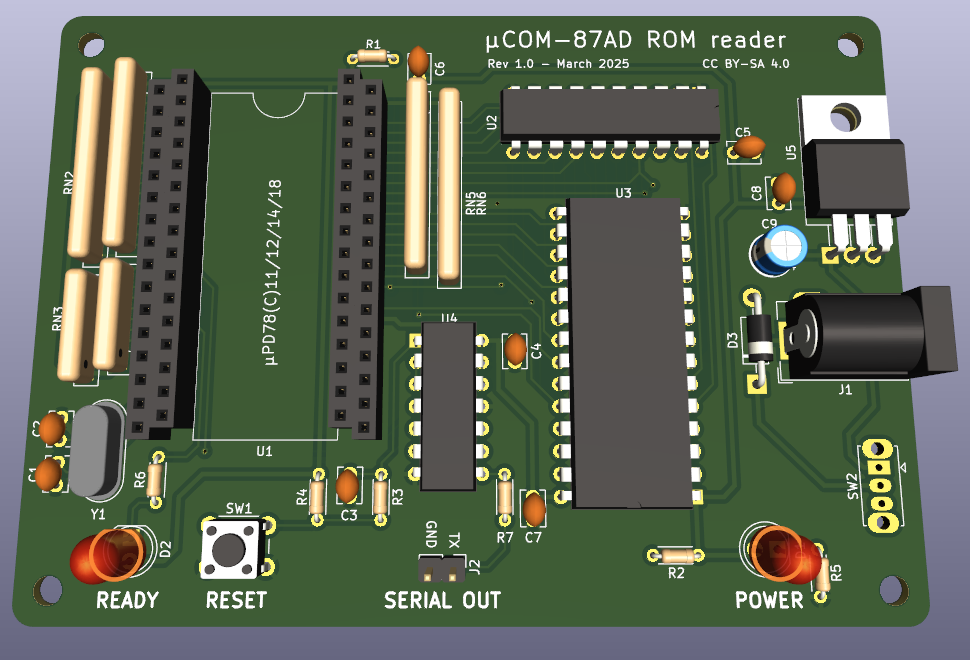

This is a PCB designed to read the internal mask ROM contents from NEC "µCOM-87AD" microcontrollers (µPD7811 aka uPD7811, etc.) and automatically output them in Intel hex format over serial.

# Specs

- Support for all NEC "µCOM-87AD" series microcontrollers:
  - uPD7811
  - uPD78C11
  - uPD78C12
  - uPD78C14
  - uPD78C18
- Automatic ROM size detection (4/8/16/32kb)
- Power input: 7.5-9V DC, center positive
- Serial output: 115200 baud, 8N1, Intel hex format

# Usage

Zipped gerbers and ROM are available from the releases page.

- Burn the firmware ROM to a 27C256 or compatible EPROM or flash chip (e.g. Atmel AT29C256, Winbond W27E257).
- Assemble the board (all parts are through-hole for convenience).
- Connect the 2-pin serial header to a USB UART adapter or something similar. Configure your computer's serial port as described in "Specs".
- Plug in power and turn the board on. The ROM dump will automatically start being dumped over serial. The "Ready" LED will flash while this is in progress, then becomes solid once it's finished.
- Press Reset or cycle power to dump again, if needed.

The resulting Intel hex file can be converted to a raw ROM image using objcopy, SRecord, or similar tools.

# Parts

| Ref | Part |
| --- | --- |
| C1, C2 | 22pF ceramic |
| C3, C4, C5, C6, C7, C8 | 0.1µF ceramic |
| C9 | 0.22µF electrolytic |
| D1 | generic 5mm 2V LED (power) |
| D2 | generic 5mm 2V LED (status) |
| D3 | 1N4001 |
| J1 | generic 3-pin barrel jack |
| J2 | 1x2 pin header, 2.54mm |
| R1, R2 | 22k ohm, 1/8 watt |
| R3, R4, R5, R6, R7 | 1k ohm, 1/8 watt |
| RN1, RN2, RN5, RN6 | 9-pin 22k ohm SIP resistors |
| RN3, RN4 | 5-pin 22k ohm SIP resistors |
| SW1 | generic 6mm tactile switch (optional, for reset) |
| SW2 | OS102011MS2QN1 |
| U1 | µPD78(C)11/12/14/18, 64-pin QUIP (four 1x16 2.54mm machined pin sockets recommended)
| U2 | 74HCT373 |
| U3 | 74HCT14 |
| U4 | 27C256 EPROM or compatible |
| U5 | LM7805 |
| Y1 | 11.0592MHz crystal |

# Disclaimer

Use this board at your own risk. It was designed to be simple, but assumes you have basic experience working with electronics, including soldering. I am not responsible if you happen to blow something up.

# License

PCB design and schematics are released under the Creative Commons Attribution-ShareAlike 4.0 (CC BY-SA) license. The firmware source (in the `rom` directory) is released as public domain.
